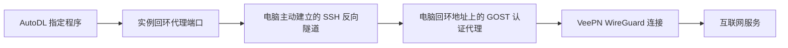

# AutoDL 网络、个人环境与 Codex 部署

为新建或重建的 AutoDL（云计算平台）实例配置个人开发环境。它让指定程序通过 PC（个人电脑）上已连接的 VeePN（虚拟专用网络软件）访问外网，复用已有 Python 环境，并安装使用个人 ChatGPT 账号登录的 Codex（编程助手）。部署后实际测试网站访问、升级和模型交互。

## 核心功能

- 为每个实例生成独立的连接配置和启动、停止、测试脚本，复用电脑已有的 GOST（网络代理转发工具）。
- 提供按进程或按当前终端启用的代理命令，让 Git、Python 和 Codex 按需联网。
- 使用官方安装器部署 Codex 完整程序包，保留随官方升级继续生效的代理入口。
- 由用户在官方页面完成 ChatGPT 授权，实际验证网站访问、账号登录、升级、模型请求和默认终端交互，交付中文使用说明及验收报告。

## 工作原理

电脑主动连接 AutoDL，并建立 SSH（安全远程连接协议）反向隧道。远端指定程序连接实例自己的回环端口，请求沿隧道送到电脑上的认证代理，再经 VeePN 的 WireGuard（虚拟专用网络协议）连接访问互联网。



每个实例各自保存连接参数、主机公钥、日志和进程身份。启动脚本识别本实例的隧道；停止脚本核对进程号、创建时间和命令后，只结束对应进程。电脑上的共享代理继续供其他连接使用。

个人代理配置放在服务器的私人主目录中。`pcvpn-run`（为一个子进程开启代理）只向目标程序注入代理变量；`pcvpn-on`（为当前命令解释器开启代理）记录原变量；`pcvpn-off`（恢复原代理环境）把原值和原先的设置状态一并恢复。

Codex 使用两层入口。外层命令负责注入代理，内部命令由官方独立安装器管理，并指向 `current`（当前发行版链接）。`codex update`（升级命令）更新内部程序包后，外层命令仍沿用原有代理配置。

## 准备条件

准备一台可以操作本机程序的 Windows 电脑，并连接 VeePN。电脑已有 GOST 桥接工程时，技能会调查并复用它的程序、启动脚本和口令文件；首次建立桥接工程时，按[网络部署说明](references/network.md)完成电脑侧配置和测试。

AutoDL 实例处于运行状态。提供控制台当前的 SSH 命令、实例简称和 VeePN 连接状态。首次主机身份核验、交互密码输入、ChatGPT 登录与二次验证均由用户在对应终端或官方页面完成。

部署助手先调查电脑和服务器的真实路径、已有认证、端口占用及 Python 环境，再填写本实例参数。所有实例配置保存在专属运行目录。

## 使用方法

把本技能整个目录放入智能助手的技能目录，在具有电脑操作能力的客户端中调用：

```text
请使用 $autodl-pc-veepn-codex 完整部署我的新 AutoDL 实例。
SSH 命令：<从 AutoDL 控制台复制的当前命令>
实例名称：<本次实例的简称>
PC 的 VeePN 已连接，使用 WireGuard。
复用已有 GOST，为本实例建立独立配置。
配置个人代理环境，以及使用个人 ChatGPT 账号登录、能够升级的 Codex。
实际完成网站、出口、升级、模型请求和默认交互测试，并交付脚本和中文说明。
账号登录和主机身份核验时，由我手动完成。
```

本实例部署成功后，在电脑的 PowerShell（Windows 命令行工具）中运行实例目录里的 `Start-AutoDL.ps1`（启动脚本），再运行 `Test-AutoDL.ps1`（测试脚本）。登录服务器后直接执行 `codex`。

测试脚本每次重新验证网络、登录和本地环境，同时列出已有的模型与升级记录。加 `-ModelTest`（重新测试模型请求与默认交互）会使用当前账号发起两次最小请求；加 `-UpdateTest`（重新执行官方升级）会实际运行升级命令。实例参数与脚本路径见[网络部署说明](references/network.md)。

## 交付结果

| 交付物 | 用途 |
|---|---|
| 独立实例目录 | 保存本实例的连接参数、主机公钥、日志和进程身份 |
| 启动、停止、测试脚本 | 管理本实例隧道并重复验证连接 |
| 个人代理命令 | 按程序或当前终端启用代理并恢复环境 |
| Codex 完整程序包与代理入口 | 使用个人 ChatGPT 账号完成编程任务并跟随官方升级 |
| 中文说明与验收报告 | 记录实际环境、验证结果、日常命令和恢复方法 |

网站测试记录 HTTP（网页传输协议）状态、CONNECT（建立代理隧道的方法）状态、TLS（传输层安全协议）证书校验结果、耗时和出口。两端同轮出口一致，说明远端代理请求沿电脑出口访问互联网。模型测试收到预期回答和完成事件，说明当前账号的模型请求链路可用。默认交互测试通过 PTY（伪终端，用来模拟真实终端交互）启动完整界面，并核对模型回答。

## 验证记录

2026 年 11 月 13 日，在两台实际 AutoDL 实例上完成部署验证。新实例使用 Ubuntu（Linux 发行版）22.04.5 LTS（长期支持版）、已有 Python 3.12.3 和 GOST 3.3.3，Codex 官方安装器解析到的版本为 0.169.0。

四项网站访问均返回 200，两端出口一致；代理认证检查返回 407；个人环境的启停与恢复、官方升级、ChatGPT 登录、真实模型请求和默认交互全部通过。详细观察值和处理方法见[实测记录](references/verified-case.md)。

## 资料来源

- [技能执行说明](SKILL.md)。
- [个人环境与 Codex 安装说明](references/environment-codex.md)。
- [验收与日常恢复](references/acceptance-recovery.md)。
- [GOST 官方文档](https://gost.run/)。
- [Codex 官方命令行文档](https://learn.chatgpt.com/docs/cli)。
- [ChatGPT 账号认证说明](https://learn.chatgpt.com/docs/auth?surface=cli)。
